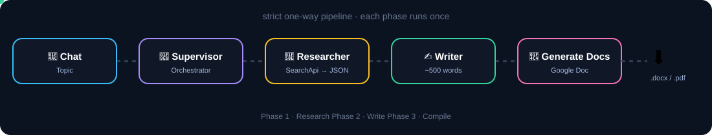
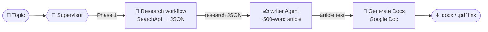

<p align="center">
  
</p>

<p align="center">
  
  
  
  
  
</p>

<h3 align="center">Send a topic in chat. Get back a researched, formatted article as a Word or PDF download link.</h3>

---

## ✨ What is this?

A **multi-agent n8n pipeline** where a master supervisor coordinates three specialists in a strict, one-way order. It never does the work itself and it never loops.

## 🎬 Pipeline in motion

<p align="center">
  
</p>



## 📦 Repository contents

| File | Role |
|---|---|
| `R+W+File supervisior.json` | Master orchestrator and chat entry point |
| `Research workflow.json` | Researcher: Google search, returns structured JSON |
| `writer Agent.json` | Writer: turns the JSON into a formatted article |
| `Generate Docs.json` | Compiler: builds a styled Google Doc and export links |

## 🧩 The three phases

### 🔎 Phase 1: Research
Searches Google with **SearchApi** and returns raw JSON only (no markdown fences, no filler):

```json
{
  "topic": "...",
  "summary": "...",
  "key_points": ["..."],
  "statistics": ["..."],
  "sources": ["URL"]
}
```

### ✍️ Phase 2: Write
Produces about 500 words, in this exact order:

`Plain-text title` → `Introduction` → `### Main sections` → `Benefits` → `Conclusion` → `References`

The supervisor audits the draft: no `#` or `**` on the title, no "Here is your article" filler.

### 📄 Phase 3: Compile
1. **Parse Input** normalizes the input and fails loudly on empty content.
2. **Create Google Doc** creates the Doc in Drive.
3. **Format Content** converts `#` to `####` headings into Docs styles (Arial, spacing).
4. **Insert Content** calls the Docs `batchUpdate` API.
5. **Edit Fields** returns `documentId`, `downloadUrl` (`.docx`) and `pdfUrl` (`.pdf`).

The supervisor then replies with a single download card:

> ### Your Document is Ready
> The article has been successfully compiled into a professional **PDF/Word** document.

<details>
<summary><b>🧠 Models used</b></summary>

| Agent | Model |
|---|---|
| Supervisor | OpenRouter `cohere/north-mini-code:free` |
| Researcher | OpenRouter `nvidia/nemotron-3-nano-30b-a3b:free` |
| Writer | OpenRouter `nvidia/nemotron-3-nano-30b-a3b:free` |

</details>

<details>
<summary><b>🛡 Supervisor guardrails</b></summary>

- A state-tracking protocol decides the phase, so each tool runs **once**.
- The Researcher is never called twice.
- Picks **PDF** for polished reports and **Word** for editable templates.
- After the link is returned, it outputs only the download card.

</details>

## 🚀 Setup

1. **Import** all four JSON files in n8n.
2. In the supervisor, re-select the imported workflow in each tool node (Research, writer Agent, Generate Docs).
3. **Add credentials**
   - OpenRouter API
   - SearchApi key
   - Google Docs OAuth2 (Docs and Drive access)
4. In **Generate Docs → Create Google Doc**, set your own Drive folder (the export has a hardcoded folder ID).
5. **Activate** the workflows, then open the chat URL.

**Try it:**

```text
Write an article on agentic AI
```

> 💡 Each sub-workflow can be tested alone. Research is pinned with `{"query": "Agentic Ai"}` and the writer is pinned with a sample research payload.

## ⚠️ Limitations and tips

- Free models may loop, skip phases or break the JSON. Use a stronger model for dependable results.
- Research and writer tool nodes have no input mapping, while both sub-workflows read `{{ $json.query }}`. Map `query` explicitly if needed.
- Docs are created in your Drive, so check sharing before using the export links.
- `Generate Docs` always returns both `.docx` and `.pdf` links; the supervisor's format choice only decides which one it shows.
- `folderId` is accepted as an input but the folder is hardcoded in the node.

## 🛠 Tech stack

`n8n` · `LangChain Agent nodes` · `OpenRouter` · `SearchApi` · `Google Docs API` · `Google Drive`

---

<p align="center"><sub>Made with ❤️ and n8n</sub></p>
